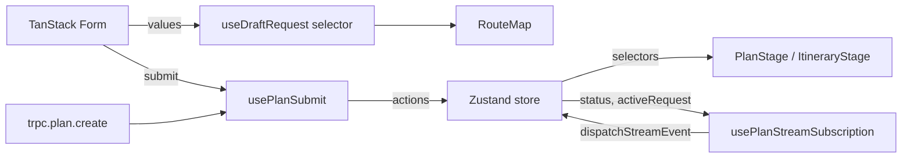

# Linear State Management

A feature is easier to read, test, and refactor when each piece of state has one
home and each hook does one thing. This skill defines the layers, the rules
between them, and a recipe for converting tangled hooks into a linear flow.

The plan feature (`src/features/plan/`) is the canonical worked example — every
section below cites it.

## Core rules

1. **One writer per state.** A given piece of state is only mutated from one
   place. If two pieces of code want to write the same value, one of them is
   wrong.
2. **Form values live in TanStack Form. Only.** Don't copy them into a Zustand
   store, React state, or refs. When the rest of the UI needs to react to a
   form value, project it via `useStore(form.store, selector)`.
3. **Workflow state lives in Zustand. Only.** Status, results, selected
   indices, async-result mirrors. The store holds *data and synchronous
   transitions*. No timers, no async, no derived `useEffect` inside the store.
4. **Side effects live in single-purpose hooks.** One hook owns one timer, one
   subscription, or one mutation lifecycle. Hooks named for the verb they
   perform: `usePlanPhaseTicker`, `usePlanSubmit`, `useDraftRequest`.
5. **Components only read selectors and dispatch actions.** No `flow` prop
   blobs. No workflow `useState`s. Components are render functions plus event
   handlers that call store actions or form handlers.

## Layer responsibilities

| Concern                                                     | Layer                                | Example                                          |
| ----------------------------------------------------------- | ------------------------------------ | ------------------------------------------------ |
| Form values (inputs, selections, draft data)                | TanStack Form `useForm`              | `src/features/plan/hooks/usePlanForm.ts`         |
| Workflow state (status, server result, selection, indices)  | Zustand `create()` store             | `src/features/plan/store.ts`                     |
| Side effects (intervals, subscriptions, mutation lifecycle) | Single-purpose hook                  | `src/features/plan/hooks/usePlanSubmit.ts` (`usePlanStreamSubscription`) |
| Derived projection (form → request, store → mode)           | `useStore` selector / store selector | `src/features/plan/hooks/useDraftRequest.ts`     |
| Component-local UI (focus, hover, dropdown open)            | `useState` inside the component      | `AddressField` in `src/features/plan/components/PlanForm.tsx` |

If a piece of state doesn't fit cleanly into one of those rows, the design is
wrong — don't add a sixth row.

## Data flow



Every arrow is one-way. Nothing writes into two places.

## Worked example: the plan feature

### The store — `src/features/plan/store.ts`

Pure data + synchronous transitions:

```ts
type PlanFlowActions = {
  startPlanning: (request: PlanRequest, optimistic: PlanResult) => void;
  setResult: (result: PlanResult) => void;
  failPlanning: () => void;
  advancePhase: () => void;
  finishPlanning: () => void;
  selectStop: (id: string) => void;
  editPlan: () => void;
};
```

Selectors are colocated and named for what they return, not for the shape of
the store:

```ts
export const useStatus = () => usePlanFlowStore((s) => s.status);
export const useMapMode = (): PlanMapMode =>
  usePlanFlowStore((s) =>
    s.status === 'planning' ? 'building'
    : s.status === 'ready' ? 'ready'
    : 'preview',
  );
```

Consumers never read the whole store. They never call `getState()` from inside
a render. They call a selector hook.

### The effect hooks

Each is named for its single job and does nothing else.

`src/features/plan/hooks/usePlanSubmit.ts` — wires `submit` / planning status
and `usePlanStreamSubscription` (tRPC stream → store). Conceptually “one mutation
lifecycle into store actions” (implementation today streams phases/stops/result):

```ts
export function usePlanSubmit() {
  const createPlan = trpc.plan.create.useMutation();
  const submit = useCallback(async (request: PlanRequest) => {
    const { startPlanning, setResult, failPlanning } =
      usePlanFlowStore.getState();
    startPlanning(request, createMockPlanResult(request));
    try {
      setResult(await createPlan.mutateAsync(request));
    } catch (e) {
      failPlanning();
      throw e;
    }
  }, [createPlan]);
  return { submit, isSubmitting: createPlan.isPending };
}
```

`src/features/plan/hooks/useDraftRequest.ts` — pure projection. No `useEffect`, no
callback wiring. Form is the source; this hook is a one-line lens:

```ts
export function useDraftRequest(form: PlanForm): PlanRequest | null {
  return useStore(form.store, (s) => {
    const { from, to, dates, activities } = s.values;
    if (from.full.trim().length === 0) return null;
    return { from, to, dates, activities };
  });
}
```

### The components

`src/features/plan/components/PlanStage.tsx` reads selectors at the point of use. No
`flow` prop:

```ts
const status = useStatus();
const result = useResult();
const selectStop = usePlanFlowStore((s) => s.selectStop);
const draftRequest = useDraftRequest(form);
```

## Anti-patterns

### God hook

```ts
function usePlanFlow() {
  const [status, setStatus] = useState('draft');
  const [result, setResult] = useState(null);
  const [draft, setDraft] = useState(null);
  const [active, setActive] = useState(null);
  const [phaseIndex, setPhaseIndex] = useState(0);
  const [selectedStopId, setSelectedStopId] = useState(null);
  const createPlan = trpc.plan.create.useMutation();
  useEffect(() => { /* phase ticker */ }, [status, result]);
  const submit = useCallback(/* optimistic + mutate + dispatch */, []);
  return { status, result, draft, active, /* ... */ };
}
```

Split into a store + one hook per effect. Components select what they need.

### Bridging a form into another store

```ts
useEffect(() => {
  const sub = form.store.subscribe(() => setDraft(form.store.state.values));
  return () => sub.unsubscribe();
}, [form, setDraft]);
```

The form is already the source of truth. Read it directly:

```ts
const draft = useStore(form.store, (s) => /* project */);
```

### `flow` prop blobs

```tsx
<PlanStage flow={flow} />
<ItineraryStage flow={flow} />
```

Pass nothing; let the child read selectors. The blob couples every consumer to
every change in the producer.

### Async / timers inside store actions

A store action that awaits or sets timers spreads non-determinism through every
selector. Keep actions synchronous and put the effect in a hook that *calls*
the action.

### `window.location.assign` to reset workflow

```ts
const editPlan = () => window.location.assign('/plan');
```

The store knows what "edit" means. Call the action:

```ts
const editPlan = usePlanFlowStore((s) => s.editPlan);
```

## Refactor recipe

Use this checklist when you find a tangled hook:

1. **Inventory the hook's responsibilities.** List every `useState`, every
   `useEffect`, every async call, every derived value. If there are more than
   two of any of these, the hook is too big.
2. **Extract data + sync actions into a Zustand store.** Add colocated
   selector hooks (`useStatus`, `useResult`, …). No effects in actions.
3. **Move each side effect into its own hook.** Name it for the verb
   (`use<X>Ticker`, `use<X>Submit`, `use<X>Subscription`). Each hook reads
   from the store via selectors and writes via actions.
4. **Replace prop-drilled blobs with selector calls** at the point of use.
   Components stop receiving `flow` and start receiving only the data they
   render.
5. **Replace cross-store sync `useEffect`s with `useStore` projections.** If
   data lives in store A and component B needs it, project from A — don't
   mirror.
6. **Delete the original god hook.**

## When NOT to use this pattern

- **Component-local UI state** (focus, hover, dropdown open, `activeIndex` in
  a combobox) stays in `useState`. Don't put it in Zustand.
- **Ephemeral form fields** stay in TanStack Form, not Zustand. Even
  meta-fields like a `fromLocked` boolean go in the form (see
  `src/features/plan/hooks/usePlanForm.ts`).
- **One-shot derived values** within a single component (e.g. `useMemo` over
  props) don't need a hook of their own.

The pattern earns its weight when state is shared across components or
survives across renders. For everything else, plain React is fine.
