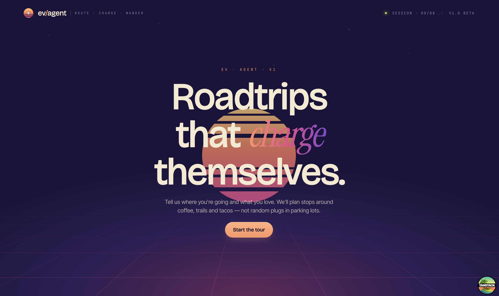
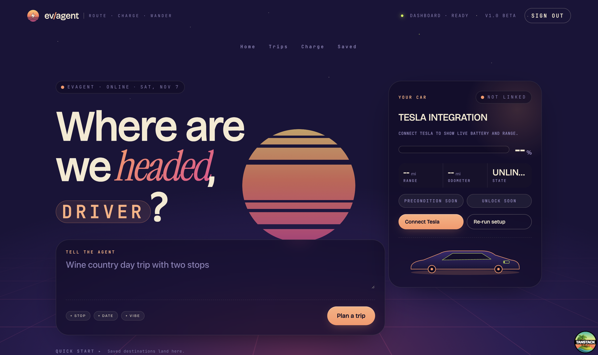
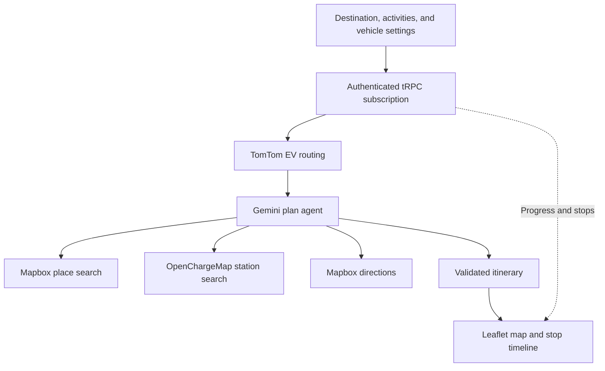

# ev/agent

ev/agent finds chargers along your road trip near the things you love doing.



Pick where you're going and what you want to do along the way. The planner brings activities, charging stops, and driving directions into a single day-trip itinerary, with a map and a stop-by-stop timeline.

## The app



- **Plan around your interests.** Choose activities such as coffee, hiking, and tacos, how long you want to stay, and roughly when you'd like to stop.
- **Bring your vehicle into the plan.** Planning uses battery capacity, consumption, starting charge, connectors, and your preferred arrival charge. A linked Tesla can supply the starting battery level.
- **Watch the itinerary take shape.** Planning progress and stops stream to the interface as the agent searches for places, chargers, and directions.
- **Explore the result.** Select stops on the map or timeline to see the route, arrival times, and time spent at each stop.
- **Connect Tesla.** Link an account through OAuth to see available battery, range, and odometer readings on the dashboard.

## How it works

TomTom supplies an initial EV route and suggested charging areas. Gemini uses that context to search for activities and charging stations, then calls Mapbox for the final driving directions.



### Technical design

- **External data gives the agent something concrete to work with.** The EV preplan contains a route corridor, charging guidance, and vehicle energy inputs. The agent's tools look up real places, stations, and driving geometry.
- **Model output has a defined contract.** Zod schemas validate the structured itinerary and individual streamed stops. If structured generation fails, the server attempts JSON repair and then a model repair pass before returning an error.
- **Long-running work has limits.** Plan subscriptions support cancellation and a 90-second timeout. Per-process guards allow one active stream per Driver and five starts per minute.
- **Vehicle defaults stay current.** Energy settings are resolved from saved overrides, the vehicle catalog, and platform defaults. Only overrides are stored, so catalog updates can flow through.
- **State has clear ownership.** TanStack Form owns form values, TanStack Query owns fetched data, and Zustand owns the planning workflow. Hooks handle subscriptions and other side effects.
- **Identity and integrations stay separate.** Clerk handles sign-in. Internal database IDs own vehicle and provider records; provider access and refresh tokens are encrypted with AES-256-GCM.

Read the [technical design](docs/technical-design.md) for the request lifecycle, failure handling, and code entry points.

### Stack

| Area | Tools |
| --- | --- |
| App | React, TypeScript, TanStack Start and Router |
| UI | Panda CSS, Ark UI, Leaflet |
| State | TanStack Form, TanStack Query, Zustand |
| API and data | tRPC, Zod, Kysely, PostgreSQL |
| Planning | Gemini through the Vercel AI SDK, TomTom, Mapbox, OpenChargeMap |
| Identity and vehicle data | Clerk, Tesla Fleet API |
| Development | Bun, Vite, Biome, Vitest, Testing Library, fallow |

## Project status

The current scope is day-trip planning with one saved vehicle per Driver. The vehicle catalog and onboarding focus on Tesla.

Some dashboard elements are still in progress: the free-text prompt opens the planning form but doesn't yet populate it; saved places, trip history, and the activity feed aren't persisted. Preconditioning and unlock controls are placeholders.

Send to Tesla has an implementation, but is disabled by default until the deployment has verified command-proxy support for navigation waypoints. See the [command proxy setup](docs/tesla-command-proxy.md).

## Run locally

You'll need Bun, Docker with the daemon running, and credentials for Clerk and the planning APIs.

```bash
bun install
cp .env.example .env
```

Fill in `.env` before starting:

| Variables | Purpose |
| --- | --- |
| `DATABASE_URL` | PostgreSQL connection; the template matches local Docker Compose |
| `CLERK_PUBLISHABLE_KEY`, `CLERK_SECRET_KEY` | Clerk development instance |
| `GEMINI_API_KEY` | Plan generation; `GEMINI_MODEL` can override the default |
| `MAPBOX_TOKEN` | Address search, places, and driving directions |
| `TOMTOM_API_KEY` | EV route prefetch; required by environment validation |
| `OPENCHARGEMAP_KEY` | Optional authentication for charging station searches |
| `OAUTH_TOKEN_ENCRYPTION_KEY`, `OAUTH_BASE_URL`, `TESLA_CLIENT_ID`, `TESLA_CLIENT_SECRET` | Tesla account linking; see [Tesla Fleet setup](docs/tesla-fleet-api.md) |

```bash
bun run db:start
bun run db:migrate
bun run prepare
bun dev
```

Open [localhost:3000](http://localhost:3000).

For local email-code authentication, use a Clerk development test address such as `devin+clerk_test@example.com` and code `424242`. Create the account through `/sign-up` first if it doesn't exist in your Clerk instance. Set `VITE_TEST_USER_EMAIL` to that address to prefill the form in development. Email verification code authentication must be enabled in Clerk.

Stop the dev process with Ctrl+C and the database with `bun run db:stop`.

### Checks and builds

```bash
bun run check         # TypeScript, Biome, coverage tests, and fallow audit
bun test              # Vitest
bun run smoke:tools   # Planning API smoke checks without an LLM call
bun run build         # Generate styles and build for production
bun run start         # Run the production server
```

CI runs the checks and tests on every pull request and pushes to `main`. Fallow compares findings against saved baselines to flag newly introduced issues.

### Find your way around

```text
src/
├── routes/                 Route composition and auth gates
├── features/               Product UI, forms, workflow state, and hooks
├── components/             Shared UI, layout, and branding
├── server/
│   ├── modules/            Domain tRPC routers
│   ├── capabilities/       Planning, EV routing, addresses, and vehicles
│   ├── integrations/       Vendor clients, including Tesla Fleet
│   ├── oauth/              Shared OAuth and token storage
│   └── platform/           Database, request context, and tRPC wiring
└── shared/                 Request/result schemas and pure helpers
```

[Domain model](CONTEXT.md) · [Vehicle energy profile decision](docs/adr/0001-vehicle-as-derived-profile.md) · [Technical design](docs/technical-design.md)
